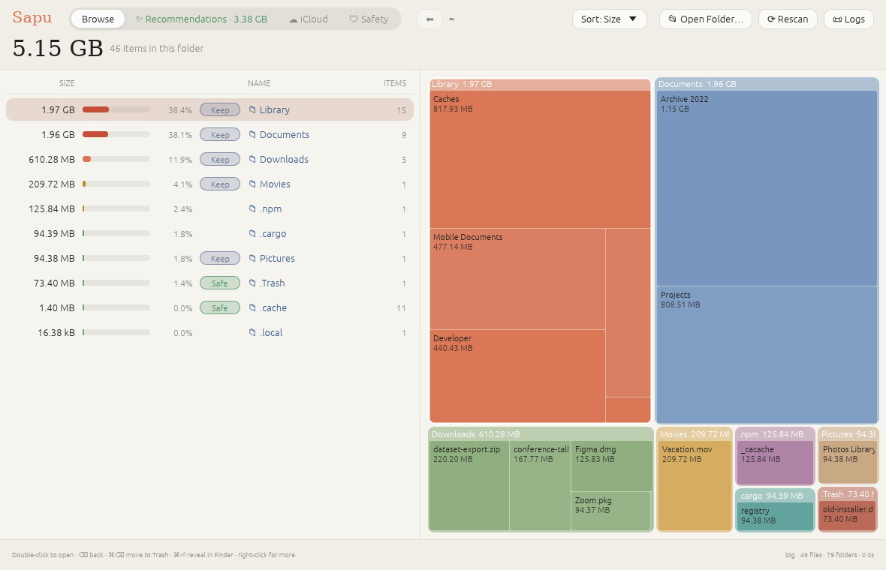
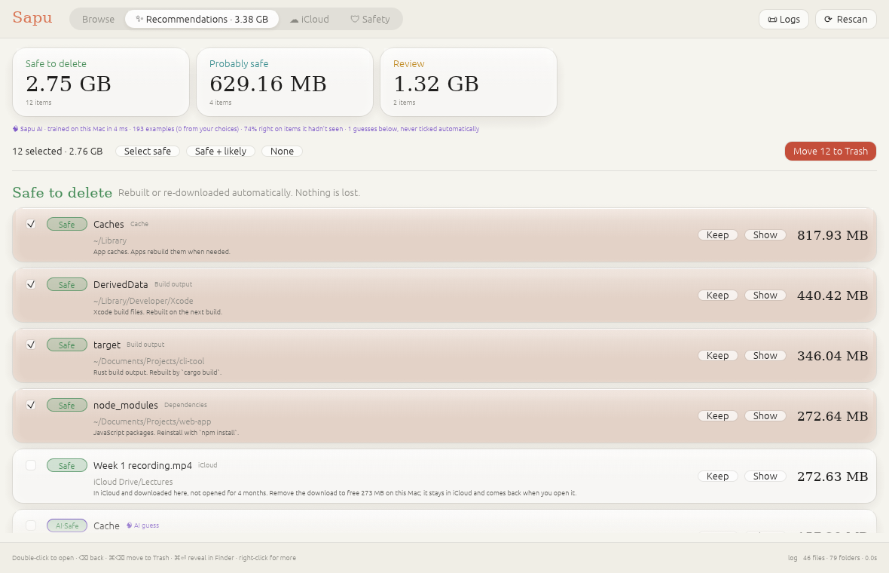
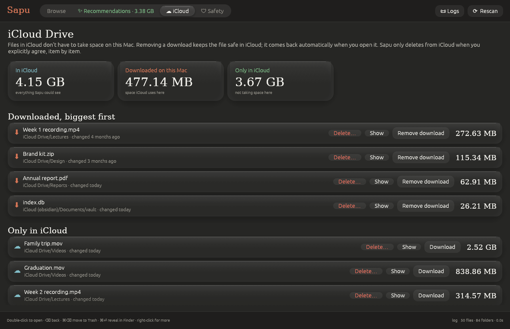
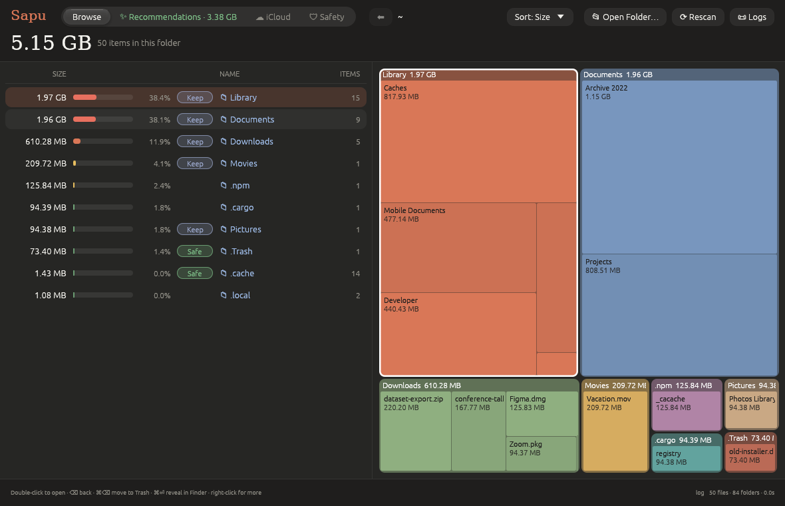
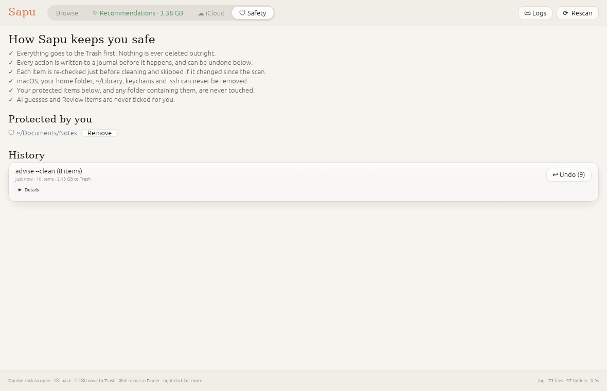

# Sapu

**A careful storage analyzer and cleaner for macOS.** See what's filling your disk,
get honest recommendations about what's safe to remove, and clean it, with everything
going to the Trash and every action undoable.

*Sapu* is Indonesian for "broom".

[](https://github.com/neccrr/sapu/actions/workflows/ci.yml)




| Recommendations | iCloud |
|---|---|
|  |  |

| Dark mode | Safety & Undo |
|---|---|
|  |  |

## Features

- **Fast scanning.** A parallel scanner builds the whole folder tree in one pass:
  700,000 files in about 5 seconds on an M-series MacBook Air. Browsing afterwards is instant,
  and the next launch opens instantly from the cached scan while a fresh one runs.
- **List + treemap.** Every folder as a sized list with usage bars, plus a squarified
  treemap that shows one level of contents inside each folder.
- **Honest judgements.** Every item gets a verdict, **Safe**, **Likely**, **Review** or
  **Keep**, with a plain-English reason.
- **Recommendations.** One list of everything worth cleaning, grouped by verdict, with
  Safe items pre-ticked and Review items left to you.
- **Sapu AI, on-device.** A small classifier trained on your Mac in milliseconds finds
  leftovers no rule names (like caches hidden inside apps). No network, no API key.
- **iCloud.** See what's downloaded vs only in iCloud. *Remove download* frees space while
  keeping the file in iCloud. Deleting from iCloud is possible, but only with your
  explicit consent, item by item.
- **Safety first.** Trash only, re-check before deleting, protected list, journal + Undo.
  See [Safety](#safety).
- **Logs.** Every action is logged; a live log window is one click (or ⌘L) away.
- **Looks at home on a Mac.** Warm palette with serif headings and glass cards. Follows
  Light/Dark.

## Install

### Download

Grab `Sapu-<version>-macos-universal.zip` from
[Releases](https://github.com/neccrr/sapu/releases), unzip, and drag **Sapu.app** into
Applications.

The app isn't notarized yet, so the first time, **right-click → Open → Open**
(or run `xattr -dr com.apple.quarantine /Applications/Sapu.app`).

### Build from source

Needs [Rust](https://rustup.rs) 1.95+.

```sh
git clone https://github.com/neccrr/sapu
cd sapu
cargo run --release                # build and open the window app
./scripts/bundle-macos.sh          # or build dist/Sapu.app
```

You can also double-click **`Sapu.command`** in Finder.

### Full Disk Access

For a complete scan (and for Undo to find items in the Trash), add **Sapu** (or Terminal,
if you run it from there) under **System Settings → Privacy & Security → Full Disk Access**.
The log says at startup whether Sapu has it.

## Using it

| Tab | What it's for |
|---|---|
| **Browse** | Explore your disk. Double-click to open a folder, ⌫ to go back, right-click for actions. |
| **✨ Recommendations** | What's worth cleaning and why. Tick, then *Move to Trash*. |
| **☁ iCloud** | Downloaded vs cloud-only. *Remove download*, *Download*, or *Delete…* (with consent). |
| **🛡 Safety** | What Sapu will never touch, your protected list, and History with **Undo**. |

| Key | Action |
|---|---|
| ⌘R | Rescan (also retrains Sapu AI) |
| ⌘O | Open another folder |
| ⌘L | Logs window |
| ↑ ↓ ⏎ ⌫ | Move, open, go back |
| ⌘⌫ / Delete | Move to Trash (asks first) |
| ⌘⏎ | Reveal in Finder |

### Terminal

```sh
cargo install --path crates/sapu-cli    # installs `sapu`

sapu                        # interactive terminal explorer
sapu scan ~ -t 30           # biggest items
sapu big ~ -n 25            # largest files anywhere
sapu advise                 # recommendations (preview)
sapu advise --clean safe    # clean Safe items (asks y/N)
sapu model                  # train Sapu AI and show its report
sapu icloud                 # iCloud summary
sapu icloud --evict <path>  # remove a download (stays in iCloud)
sapu icloud --delete <path> # delete from iCloud everywhere (type "delete" to confirm)
sapu history                # what was cleaned
sapu undo                   # put the last batch back
sapu protect <path>         # never touch this
sapu data                   # where Sapu keeps its data, and how big it is
```

`-v` / `-vv` for more logs, `-q` for errors only.

## How judgements work

Rules are checked in priority order, and the first match wins:

1. **Keep:** macOS, keychains, `.ssh`, `.git`, Photos libraries, your personal folders.
2. **iCloud:** only *Remove download* is suggested; deleting needs consent.
3. **Known locations:** `~/Library/Caches`, logs, Xcode DerivedData, package-manager caches…
4. **Project leftovers:** `node_modules`, Rust `target/` (only if `Cargo.toml` is next to it),
   Python venvs (only with `pyvenv.cfg`), CocoaPods, web build caches…
5. **File types:** installers (`.dmg`, `.pkg`), old archives in Downloads.
6. **Age + size:** big things nobody has touched in a long time → Review.

Anything no rule recognises can be judged by **Sapu AI**: multinomial logistic
regression over hashed features of the item's name, location, size and age. It's trained
on a hand-labelled seed set, the rules' verdicts on your own disk, and your choices
(Keep / trash). It only fills gaps (rules always win), needs ≥ 85% confidence, must have
evidence about the item itself (not just its location), never suggests an app's whole
data folder, and its guesses are never pre-ticked. `sapu model` prints accuracy on
held-out data, a confusion matrix and the strongest signals per class.

## Safety

Every removal passes through these layers:

1. **You choose.** Nothing happens without a click or `--clean`. Review items and AI
   guesses are never pre-ticked; risky or huge batches need an extra "I've checked" tick.
2. **Re-check.** Right before each item, Sapu confirms it still matches the scan and
   skips it if it changed.
3. **Hard rules.** Never `/System`, `/usr`, `/Library`…, never your home folder itself,
   `~/Library` itself, keychains or `.ssh`.
4. **Your protected list.** Right-click → 🛡 Protect, or `sapu protect <path>`. Protected
   items, and any folder containing one, are never touched.
5. **iCloud consent.** Deleting anything in iCloud removes it from all your devices, so it
   needs an explicit "I understand" (or typing `delete`). The core refuses otherwise,
   automatic cleaning never touches iCloud, and whole iCloud folders can't be deleted.
6. **Warnings.** Old folders containing a git repository or Photos library are flagged.
7. **Write-ahead journal.** Each item is logged *before* it's touched, then logged with
   where it landed in the Trash.
8. **Trash only.** Nothing is ever deleted outright.
9. **Undo.** 🛡 Safety → *Undo*, or `sapu undo`, puts a whole batch back. (It can't bring
   back what you've already emptied from the Trash.)

## Logs

📜 **Logs** (⌘L) opens a live log window with level filters, search and copy. The full log
is at `~/Library/Logs/sapu/sapu-gui.log` (open it in Console.app). `SAPU_LOG=debug` for more
detail. When reporting a bug, Logs → Copy is the most useful thing to include.

## Where Sapu keeps its data

Everything stays on your Mac: never inside Sapu.app and never online. Downloading a new
version of the app keeps it all.

```text
~/Library/Application Support/sapu/   things you'd miss: keep
  ai/model.bin            Sapu AI (retrained on every scan)
  ai/feedback.tsv         your Keep / trash choices, which teach the AI
  safety/protected.txt    your "never touch" list
  safety/journal.jsonl    everything moved to the Trash (powers Undo)
~/Library/Caches/sapu/                safe to delete anytime
  scans/<id>.bin          last scan of each folder, for an instant start
~/Library/Logs/sapu/                  sapu-gui.log, sapu.log (rotated at 10 MB)
```

See sizes and open these folders in **🛡 Safety → Data on this Mac**, or run `sapu data`.
To remove Sapu completely, delete Sapu.app and those three `sapu` folders.

## Options

| Variable | Effect |
|---|---|
| `SAPU_THEME=light\|dark` | Force a theme (default: follow macOS) |
| `SAPU_GLASS=1` | Experimental: translucent window with the macOS blur behind it |
| `SAPU_LOG=debug` | More detail in the log file |


## How it's built

A Rust workspace with three crates:

```
crates/
├── sapu-core/     engine, no UI
│   ├── scanner.rs     parallel tree scan (rayon), hard-link dedupe, one volume
│   ├── tree.rs        tree model, remove/replace with totals, largest-files search
│   ├── judge.rs       judgement rules → verdict + reason + action
│   ├── advisor.rs     walks the tree, builds recommendations
│   ├── ml/            Sapu AI: features, model, dataset (+ seed.tsv)
│   ├── icloud.rs      iCloud summary, remove download, download
│   ├── safety.rs      hard rules, protected list, iCloud consent gate
│   ├── cleaner.rs     re-check → safety → journal → Trash
│   ├── journal.rs     write-ahead journal, find-in-Trash, Undo
│   ├── cache.rs       scan cache (instant start)
│   └── paths.rs       where Sapu keeps its data
├── sapu-gui/      window app (egui/eframe): list, treemap, tabs, logs window
└── sapu-cli/      `sapu` command + terminal explorer (ratatui)
```

## Contributing

Issues and PRs are welcome. See [CONTRIBUTING.md](CONTRIBUTING.md). New cleanup rules
especially: tell us the path, which app creates it, and how you know it's safe.

## License

[MIT](LICENSE)
